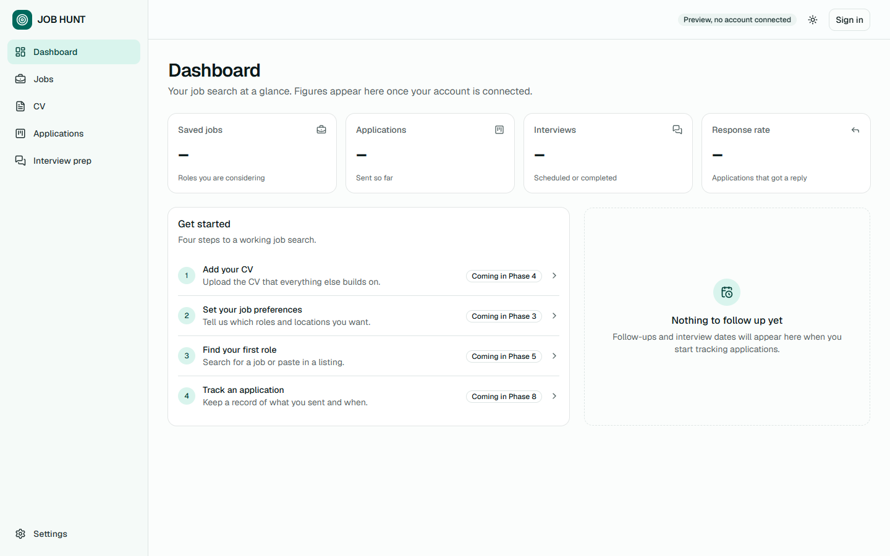

# JOB HUNT

An AI-powered job search and career management platform. JOB HUNT will find relevant roles, analyse job descriptions, match them against your CV, tailor your CV and cover letters, track applications, prepare you for interviews and show analytics on your search.




## Project status

| Phase | Status |
| ----- | ------ |
| 1. Planning and architecture | ✅ Complete, see [docs](docs/README.md) |
| 2. Application foundation | ✅ Complete |
| 3. Authentication and database | Next |
| 4 to 11. Product features and launch | Planned, see the [roadmap](docs/07-roadmap.md) |

This is the frontend foundation. **There is no backend yet**: accounts, job search, CV upload and AI features are not connected. Pages show real empty states and mark what is coming, with no fake data. The login and registration forms do not send or store anything. The only working setting is the theme, which is saved in your browser.

## Tech stack

- Next.js 16 (App Router) and React 19
- TypeScript
- Tailwind CSS 4 and shadcn/ui
- ESLint

Planned from Phase 3: Supabase (PostgreSQL, Auth, Storage), the Anthropic API and Vercel.

## Run it locally

You need [Node.js](https://nodejs.org) 22 or later. No environment variables are needed yet.

```bash
git clone https://github.com/kgiannopoulou/JOB-HOUNT-RUN-BY-CLAUDE-CODE.git
cd JOB-HOUNT-RUN-BY-CLAUDE-CODE
npm install
npm run dev
```

Then open <http://localhost:3000>.

| Command | What it does |
| ------- | ------------ |
| `npm run dev` | Start the development server |
| `npm run build` | Create a production build, including type checks |
| `npm run start` | Serve the production build |
| `npm run lint` | Run ESLint |

## Project structure

```text
docs/                 Requirements, architecture and plans
src/
  app/
    (marketing)/      Landing page
    (auth)/           Login and registration
    (app)/            Dashboard, jobs, CV, applications, interview prep, settings
  components/
    ui/               shadcn/ui primitives
    layout/           Sidebar, top bar, navigation, logo, theme toggle
    shared/           Page header, empty state, stat card, phase badge
    marketing/        Landing page sections
    auth/             Authentication form
    settings/         Settings forms
    providers/        Theme provider
  config/             Site details and navigation
  lib/                Utilities
```

## Documentation

The full plan is in [docs](docs/README.md): requirements, architecture, database design, pages, API, security, roadmap, testing, risks and [open questions](docs/10-open-questions.md).
