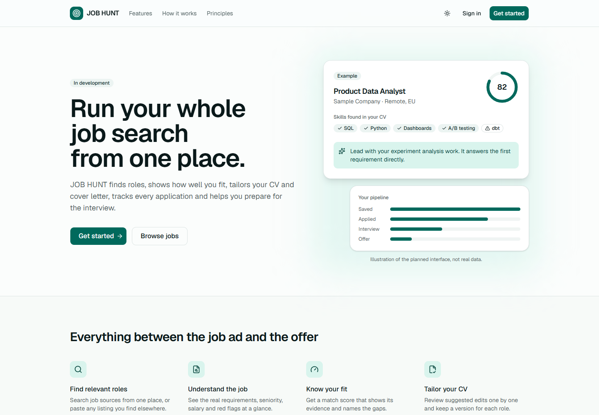
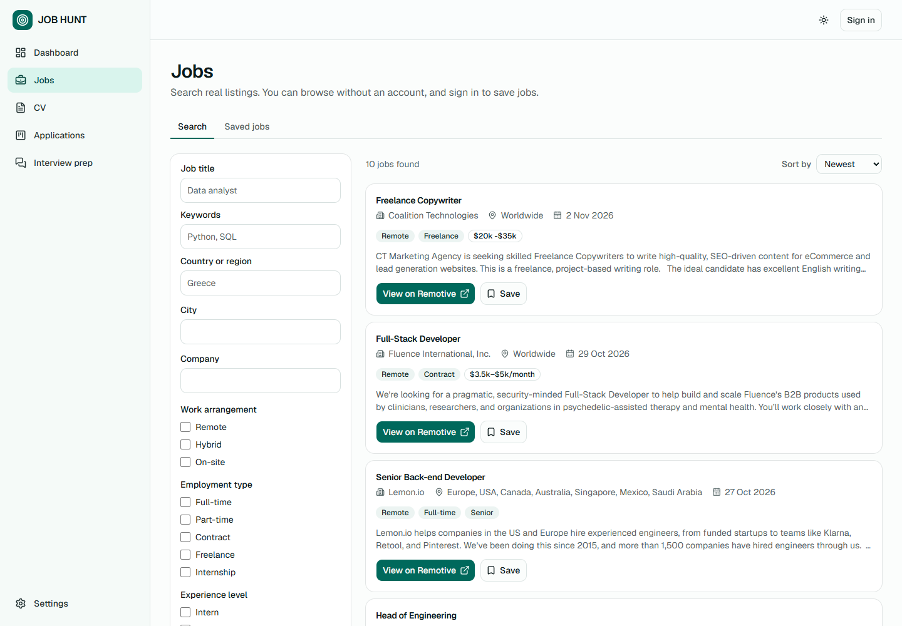

# JOB HUNT

An AI-powered job search and career management platform. JOB HUNT will find relevant roles, analyse job descriptions, match them against your CV, tailor your CV and cover letters, track applications, prepare you for interviews and show analytics on your search.





## Project status

| Phase | Status |
| ----- | ------ |
| 1. Planning and architecture | ✅ Complete, see [docs](docs/README.md) |
| 2. Application foundation | ✅ Complete |
| 3. Database and authentication | ✅ Complete on local Supabase |
| 4. Job discovery | ✅ Complete, with Remotive as the first source |
| 5 to 11. CV, AI features, tracking, launch | Planned, see the [roadmap](docs/07-roadmap.md) |

**What works today:** registration with email confirmation, login, logout, password reset, private profiles and preferences, public job search over real listings with filters, and saved jobs. CV upload, applications and interview preparation are protected pages with no feature behind them yet, and they say so.

**Known limit:** Remotive's free feed currently holds only 10 jobs, all remote. See [job data sources](docs/09-risks-and-dependencies.md#93-job-data-sources).

## Tech stack

- Next.js 16 (App Router), React 19 and TypeScript
- Tailwind CSS 4 and shadcn/ui
- Supabase: PostgreSQL with row level security, and Auth
- Vitest, Testing Library and Playwright
- GitHub Actions

Planned: the Anthropic API, Supabase Storage and Vercel.

## Run it locally

You need [Node.js](https://nodejs.org) 22 or later and [Docker Desktop](https://www.docker.com/products/docker-desktop/).

```bash
git clone https://github.com/kgiannopoulou/JOB-HOUNT-RUN-BY-CLAUDE-CODE.git
cd JOB-HOUNT-RUN-BY-CLAUDE-CODE
npm install
cp .env.example .env.local
npm run db:start
```

`db:start` prints your local keys. Add them to `.env.local`, then:

```bash
npm run dev
npm run jobs:sync
```

Open <http://localhost:3000>. The [setup guide](docs/setup.md) covers this in full, along with hosted Supabase, Vercel and adding job providers.

| Command | What it does |
| ------- | ------------ |
| `npm run dev` | Start the development server |
| `npm run build` | Create a production build, including type checks |
| `npm run lint` | Run ESLint |
| `npm test` | Run unit tests |
| `npm run test:integration` | Run database tests against local Supabase |
| `npm run test:e2e` | Run browser tests against a production build |
| `npm run db:start` / `db:stop` / `db:reset` | Manage local Supabase |
| `npm run db:types` | Regenerate database types |
| `npm run jobs:sync` | Fetch jobs, within the provider's limits |

## Project structure

```text
docs/                 Requirements, architecture, plans and setup
scripts/              Job sync and test runners
supabase/migrations/  Database schema, as versioned SQL
tests/                Unit, integration and end-to-end tests
src/
  app/
    (marketing)/      Landing page
    (auth)/           Login and registration
    (app)/            Dashboard, jobs, CV, applications, interview prep, settings
    api/internal/     Job sync endpoint
    auth/confirm/     Email link handler
  components/
    ui/               shadcn/ui primitives
    layout/           Sidebar, top bar, navigation, logo, theme toggle
    shared/           Page header, empty state, stat card, phase badge
    marketing/        Landing page sections
    auth/             Authentication forms
    jobs/             Job search, filters and cards
    settings/         Settings forms
    providers/        Theme provider
  config/             Site details and navigation
  lib/                Shared utilities
  server/             Server-only code: auth, Supabase clients, job providers, sync
  types/              Generated database types
  proxy.ts            Session refresh and route redirects
```

## Documentation

The full plan is in [docs](docs/README.md): requirements, architecture, [database schema](docs/03-database-design.md), pages, API, security, roadmap, testing, risks and [open questions](docs/10-open-questions.md).
