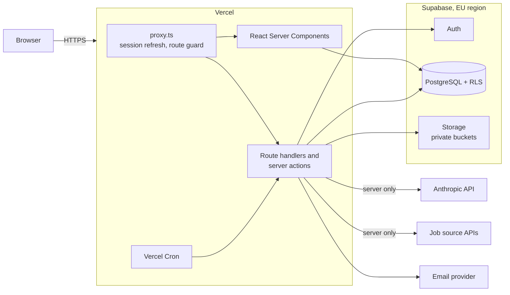
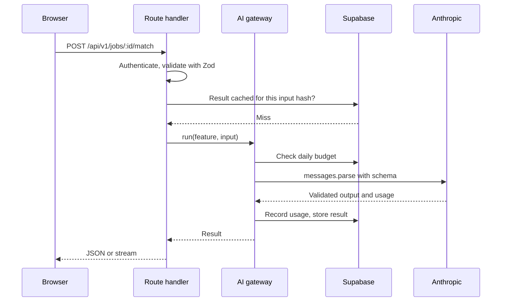

# 2. System architecture

## 2.1 Overview

JOB HUNT is a single Next.js application deployed on Vercel, backed by Supabase. There is no separate backend service: route handlers and server actions hold the server logic, and the Anthropic API key never reaches the browser.



## 2.2 Technology

| Layer | Choice | Notes |
| ----- | ------ | ----- |
| Framework | Next.js 16 App Router, React 19 | Cache Components enabled. `proxy.ts` replaces `middleware.ts` in this version |
| Language | TypeScript, strict mode | |
| Styling | Tailwind CSS 4, shadcn/ui on Radix | Design tokens live in `globals.css` |
| Database | Supabase PostgreSQL | Row level security on every user table |
| Auth | Supabase Auth through `@supabase/ssr` | Cookie sessions |
| Files | Supabase Storage | Private buckets, short-lived signed URLs |
| AI | Anthropic API through `@anthropic-ai/sdk` | Server only |
| Validation | Zod | One schema shared by forms, API input and AI output |
| Hosting | Vercel | Preview deployment for every pull request |

Node.js 22 or later is required because of the `cn` package used by shadcn/ui.

## 2.3 Application layers

```text
src/
  app/
    (marketing)/     public landing page
    (auth)/          login and registration
    (app)/           signed-in product: dashboard, jobs, cv, applications, interview, settings
    api/v1/          route handlers (from Phase 3)
  components/
    ui/              shadcn/ui primitives
    layout/          shell, sidebar, top bar, navigation, logo
    shared/          page header, empty state, stat card
    marketing/       landing page sections
    auth/            authentication forms
    settings/        settings forms
  config/            site and navigation definitions
  lib/               utilities
  server/            (from Phase 3) marked server-only
    ai/              Anthropic client, prompts, schemas, usage metering
    db/              typed queries
    jobs/            job source adapters
  proxy.ts           (from Phase 3) session refresh and route protection
supabase/
  migrations/        (from Phase 3) versioned SQL
```

Rules:

- Pages read data in Server Components. Mutations go through server actions, or through route handlers when they stream or are called by cron.
- Anything under `src/server` imports `server-only`, so accidental client use fails the build.
- `proxy.ts` is an optimistic check for redirects only. Authorisation is enforced again at the data layer by RLS and in each handler.

## 2.4 AI layer

Every AI feature goes through one internal function, so limits, logging, validation and error handling exist in one place.



### Model and request settings

The default for every feature is **Claude Opus 5.5** (`claude-opus-5-5`), read from one `ANTHROPIC_MODEL` setting. Cost is controlled per feature through `output_config.effort`. Moving some features to a cheaper model is a [decision for the project owner](10-open-questions.md).

| Feature | Output | Effort | Delivery |
| ------- | ------ | ------ | -------- |
| CV parsing (PDF sent directly as a document block) | Structured | low | Background |
| Job analysis | Structured | low | Request, cached per job |
| Match scoring | Structured | medium | Request, cached per job and CV version |
| CV tailoring suggestions | Structured | high | Request |
| Cover letter | Text | high | Streamed |
| Interview questions | Structured | medium | Request |
| Answer feedback | Structured | medium | Streamed |

### API details the code must respect

Checked against the current Anthropic documentation for `claude-opus-5-5`:

- Structured results use `client.messages.parse()` with `output_config.format`. Assistant prefill and forced `tool_choice` both return a 400.
- Thinking cannot be disabled and `budget_tokens` is rejected. Effort is the only control, and its default is `medium`, so it is always set explicitly.
- `temperature`, `top_p` and `top_k` are rejected.
- Always check `stop_reason` before reading content. `refusal` and `max_tokens` are normal outcomes that the UI must handle. Server-side `fallbacks` are enabled for refusals.
- Long generations stream, using `.stream()` and `.finalMessage()`.
- Citations cannot be combined with structured output, so evidence for match scores is returned as quoted fields in the schema and verified in code.

### Cost control

- **Result cache.** Results are stored by a hash of the prompt version and input. The same job and CV are never scored twice.
- **Prompt caching.** The stable system prompt and CV come first in the request, marked with `cache_control`, so scoring several jobs against one CV reuses the prefix. Verified with `usage.cache_read_input_tokens`.
- **Batches.** Saved-search scoring runs overnight through the Message Batches API at half price.
- **Budgets.** Each user has a daily limit, checked before every call and recorded in `ai_usage`.

## 2.5 Job ingestion

Each job source implements one adapter interface, so sources can be added or dropped without touching the rest of the code.

```ts
interface JobSource {
  id: string;
  search(query: JobQuery): Promise<NormalizedJob[]>;
}
```

Results are normalised and stored in a shared `jobs` table, with a fingerprint of company, title and location used to merge duplicates. The source's link and attribution are kept, as their terms usually require. Vercel Cron refreshes saved searches on a schedule. See [risks](09-risks-and-dependencies.md) for what each source allows.

## 2.6 Background work

Vercel functions have time limits, so anything long is split up:

| Work | Approach |
| ---- | -------- |
| CV parsing | Runs after the upload response returns, with a `status` column the UI polls |
| Saved-search refresh | Vercel Cron calling a secret-protected route |
| Bulk scoring | Message Batches, submitted by cron and collected by a later cron run |
| Data export | Generated into private storage, with a signed link |

## 2.7 Environments

| Environment | Hosting | Database |
| ----------- | ------- | -------- |
| Local | `npm run dev` | Supabase CLI (Docker) |
| Preview | Vercel preview per pull request | Shared staging project |
| Production | Vercel | Production project, EU region |

Secrets live in Vercel environment variables and in an uncommitted `.env.local`. Only values prefixed `NEXT_PUBLIC_` reach the browser, and those are limited to the Supabase URL and publishable key.

## 2.8 Key decisions

| Decision | Reason | Alternative rejected |
| -------- | ------ | -------------------- |
| One Next.js app | Least to run, and it matches the requested stack | Separate API service, which adds deployment and auth work with no benefit at this size |
| RLS as the main authorisation layer | A forgotten check in a handler cannot leak another user's data | Checks only in application code |
| Shared `jobs` table with per-user `saved_jobs` | Avoids repeating job data and repeating AI analysis | A private copy of each job per user |
| AI output stored, not recomputed | Cost, speed and a record of what was shown | Generating on every view |
| Single AI gateway | Limits and logging cannot be bypassed by a new feature | Calling the SDK from each handler |
