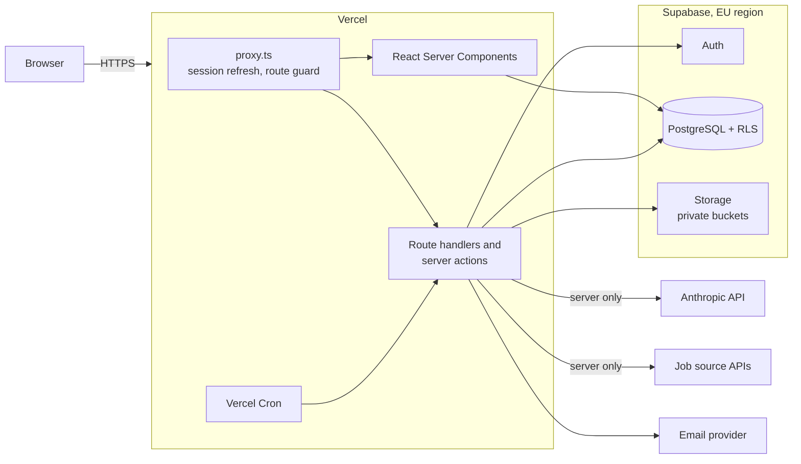
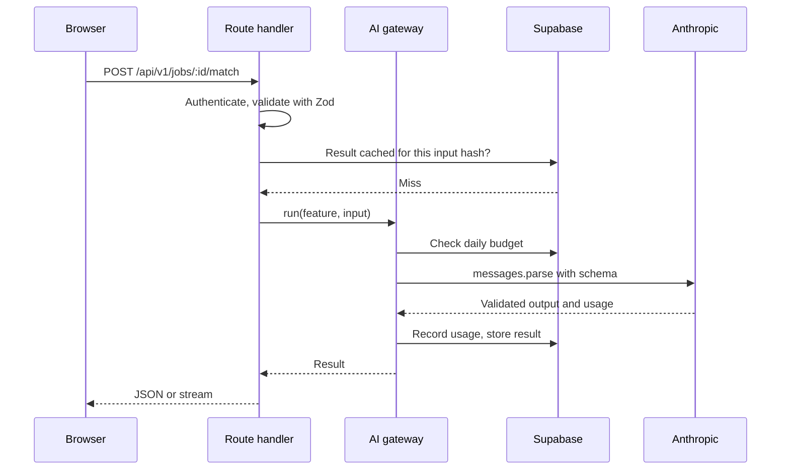
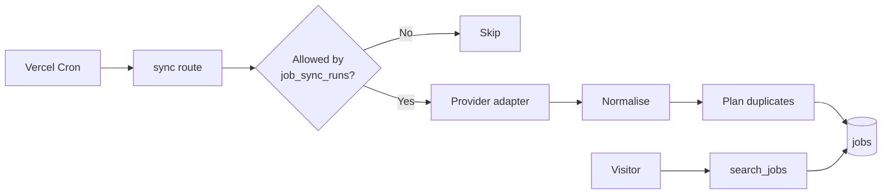

# 2. System architecture

## 2.1 Overview

JOB HUNT is a single Next.js application deployed on Vercel, backed by Supabase. There is no separate backend service: route handlers and server actions hold the server logic, and the Anthropic API key never reaches the browser.



## 2.2 Technology

| Layer | Choice | Notes |
| ----- | ------ | ----- |
| Framework | Next.js 16 App Router, React 19 | Cache Components enabled. `proxy.ts` replaces `middleware.ts` in this version |
| Language | TypeScript, strict mode | |
| Styling | Tailwind CSS 4, shadcn/ui on Radix | Design tokens live in `globals.css` |
| Database | Supabase PostgreSQL | Row level security on every user table |
| Auth | Supabase Auth through `@supabase/ssr` | Cookie sessions |
| Files | Supabase Storage | Private buckets, short-lived signed URLs |
| AI | Anthropic API through `@anthropic-ai/sdk` | Server only |
| Validation | Zod | One schema shared by forms, API input and AI output |
| Hosting | Vercel | Preview deployment for every pull request |

Node.js 22 or later is required because of the `cn` package used by shadcn/ui.

## 2.3 Application layers

```text
src/
  app/
    (marketing)/     public landing page
    (auth)/          login and registration
    (app)/           signed-in product: dashboard, jobs, cv, applications, interview, settings
    api/internal/    cron routes
    auth/confirm/    email link handler
  components/
    ui/              shadcn/ui primitives
    layout/          shell, sidebar, top bar, navigation, logo
    shared/          page header, empty state, stat card
    marketing/       landing page sections
    auth/            authentication forms
    settings/        settings forms
  config/            site and navigation definitions
  lib/               utilities
  server/            server code: env, Supabase clients, auth, profile
    jobs/            providers, normalisation, duplicates, sync, search
    ai/              (planned) Anthropic client, prompts, schemas, metering
  types/             generated database types
  proxy.ts           session refresh and route redirects
supabase/
  migrations/        versioned SQL
tests/               unit, integration and end-to-end tests
```

Rules:

- Pages read data in Server Components. Mutations go through server actions, or through route handlers when they stream or are called by cron.
- Modules that hold credentials import `server-only`, so accidental client use fails the build.
- `proxy.ts` is an optimistic check for redirects only. Authorisation is enforced again at the data layer by RLS and in each handler.

## 2.4 AI layer

Every AI feature goes through one internal function, so limits, logging, validation and error handling exist in one place.



### Model and request settings

The default for every feature is **Claude Opus 5.5** (`claude-opus-5-5`), read from one `ANTHROPIC_MODEL` setting. Cost is controlled per feature through `output_config.effort`. Moving some features to a cheaper model is a [decision for the project owner](10-open-questions.md).

| Feature | Output | Effort | Delivery |
| ------- | ------ | ------ | -------- |
| CV parsing (text read from the file on the server) | Structured | low | Request, started by the user |
| CV analysis | Structured | medium | Request, cached per verified profile |
| Job matching (requirements and evidence, no score) | Structured | medium | Request, cached per job and CV content |
| CV tailoring suggestions | Structured | high | Request |
| Cover letter | Text | high | Streamed |
| Interview questions | Structured | medium | Request |
| Answer feedback | Structured | medium | Streamed |

### API details the code must respect

Checked against the current Anthropic documentation for `claude-opus-5-5`:

- Structured results use `output_config.format`, with the response validated by the same Zod schema. The gateway calls `create` rather than `parse`, because `parse` throws on cut-off text before `stop_reason` can be read. Assistant prefill and forced `tool_choice` both return a 400.
- Thinking cannot be disabled and `budget_tokens` is rejected. Effort is the only control, and its default is `medium`, so it is always set explicitly.
- `temperature`, `top_p` and `top_k` are rejected.
- Always check `stop_reason` before reading content. `refusal` and `max_tokens` are normal outcomes that the UI must handle. Server-side `fallbacks` are enabled for refusals.
- Long generations stream, using `.stream()` and `.finalMessage()`. Structured calls in Phases 5 and 6 stay within 16,000 output tokens and do not need it.
- Citations cannot be combined with structured output, so evidence for match scores is returned as quoted fields in the schema and verified in code.

### Matching and scoring

The model never produces a number. It lists each requirement with a quote from the job, and pairs it with a quote from the verified profile. `scoreMatch` in `src/lib/matching/score.ts` then applies fixed rules:

| Rule | Value |
| ---- | ----- |
| Credit | Met 100%, partly met 50%, not met 0% |
| Importance | Mandatory counts 3, preferred counts 1. Words in the job's own quote override the model's choice |
| Category weights | Skills 35, experience 20, responsibilities 15, education 10, certifications 10, seniority 5, languages 5. Categories the job does not mention are left out |
| Evidence | Credit needs a quote found in the verified profile. A requirement needs a quote found in the job |
| Calculated facts | Total years come from role dates, with overlaps counted once. A skill or certification listed in the profile is met |
| Caps | Any mandatory requirement missing: at most 74. Half or more missing: at most 49 |
| Bands | Strong from 75, moderate from 50, otherwise limited. No checkable requirements: no score |

These are product choices, not validated predictions. The score is never described as a chance of being hired.

### Cost control

- **Result cache.** Results are stored by a hash of the prompt version and input. The same job and CV are never scored twice.
- **Prompt caching.** The stable system prompt and CV come first in the request, marked with `cache_control`, so scoring several jobs against one CV reuses the prefix. Verified with `usage.cache_read_input_tokens`.
- **Batches.** Planned: saved-search scoring overnight through the Message Batches API at half price.
- **Budgets.** Each user has a daily limit, 30 calls in 24 hours by default (`AI_DAILY_LIMIT`), checked before every call and recorded in `ai_usage`.

## 2.5 Job ingestion

Each job source implements one adapter interface, so sources can be added or dropped without touching the rest of the code.

```ts
interface JobProvider {
  id: string;
  name: string;
  minSyncIntervalMs: number; // shortest gap the provider's terms allow
  fetchJobs(): Promise<ProviderResult>;
}
```



Searches read only our database and never call a provider. Provider limits are small (Remotive advises 4 requests a day) and their APIs offer few filters, so running everything against our own table meets both needs. Each sync normalises results, updates known jobs and skips duplicates using a fingerprint of company, title and locations. Every job keeps its provider, original URL and publication date. See [risks](09-risks-and-dependencies.md) for what each source allows.

## 2.6 Background work

Vercel functions have time limits, so anything long is split up:

| Work | Approach |
| ---- | -------- |
| CV parsing | Runs when the user chooses to, inside a server action. Pages with AI actions set `maxDuration` to 240 seconds, which must be confirmed against the Vercel plan. A `parse_status` claim stops double runs |
| Job sync | Vercel Cron calling a secret-protected route, once a day |
| Bulk scoring | Message Batches, submitted by cron and collected by a later cron run |
| Data export | Generated into private storage, with a signed link |

## 2.7 Environments

| Environment | Hosting | Database |
| ----------- | ------- | -------- |
| Local | `npm run dev` | Supabase CLI (Docker). See [setup](setup.md) |
| Preview | Vercel preview per pull request | Shared staging project |
| Production | Vercel | Production project, EU region |

Secrets live in Vercel environment variables and in an uncommitted `.env.local`. Only values prefixed `NEXT_PUBLIC_` can reach the browser, and those are limited to the Supabase URL and publishable key. Authentication and CV uploads run in server actions, so no Supabase client is shipped to the browser yet.

## 2.8 Key decisions

| Decision | Reason | Alternative rejected |
| -------- | ------ | -------------------- |
| One Next.js app | Least to run, and it matches the requested stack | Separate API service, which adds deployment and auth work with no benefit at this size |
| RLS as the main authorisation layer | A forgotten check in a handler cannot leak another user's data | Checks only in application code |
| Shared `jobs` table with per-user `saved_jobs` | Avoids repeating job data and repeating AI analysis | A private copy of each job per user |
| AI output stored, not recomputed | Cost, speed and a record of what was shown | Generating on every view |
| Single AI gateway | Limits and logging cannot be bypassed by a new feature | Calling the SDK from each handler |
