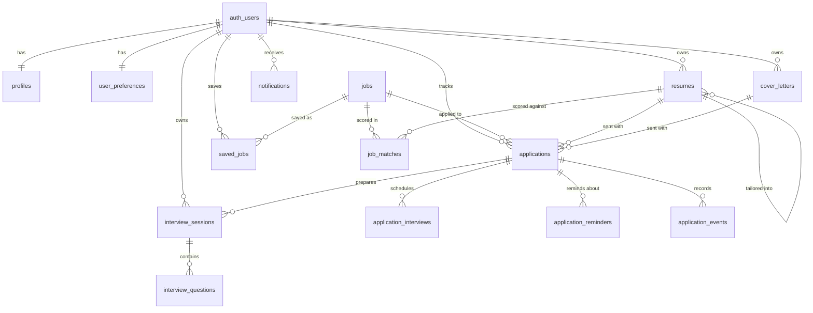

# 3. Database design

PostgreSQL on Supabase. This document describes the schema as built. The source of truth is `supabase/migrations`, and every change is a new migration. TypeScript types in `src/types/database.ts` are generated from it with `npm run db:types`.

| Migration | Contents |
| --------- | -------- |
| `20261106100000_core_schema.sql` | Enums, tables, foreign keys, indexes, triggers |
| `20261106100100_row_level_security.sql` | Row level security policies and grants |
| `20261106100200_job_discovery.sql` | Saved jobs, sync history, search functions |
| `20261107100000_cv_analyzer.sql` | CV storage, analyses, AI budget |
| `20261107110000_cv_builder.sql` | CV versions, layouts, cover letter columns |
| `20261107120000_application_tracker.sql` | Board stages, interviews, reminders, history, status rules |

## 3.1 Entity relationships



## 3.2 Tables

All primary keys are UUIDs unless noted, and all timestamps are `timestamptz`.

### Identity

**`profiles`**: created by a trigger when an account is created.

| Column | Type | Notes |
| ------ | ---- | ----- |
| `id` | uuid PK | References `auth.users`, removed with the account |
| `full_name`, `headline`, `location` | text | Up to 200 characters |
| `linkedin_url` | text | Up to 500 characters |

**`user_preferences`**: also created by the trigger.

| Column | Type | Notes |
| ------ | ---- | ----- |
| `user_id` | uuid PK | References `auth.users` |
| `desired_titles`, `desired_locations` | text[] | |
| `remote_policies` | remote_policy[] | |
| `employment_types` | employment_type[] | |
| `experience_level` | experience_level | |
| `min_salary` | numeric | Must not be negative |
| `salary_currency` | text | Three letters, default `EUR` |
| `email_notifications` | boolean | Default false |

### Jobs

**`jobs`**: shared by all users and written only by the server.

| Column | Type | Notes |
| ------ | ---- | ----- |
| `id` | uuid PK | |
| `provider`, `provider_job_id` | text | Unique together. Records the source |
| `fingerprint` | text, unique | Hash of normalised company, title and locations. Blocks duplicates across providers |
| `title`, `company`, `description` | text | Description is plain text, never provider HTML |
| `source_url` | text | The original advert. Must start with `http://` or `https://` |
| `location_raw` | text | Location as the provider wrote it |
| `locations` | text[] | One spelling per place. GIN index |
| `city` | text | |
| `remote_policy` | enum | `remote`, `hybrid`, `onsite`, `unknown` |
| `employment_type` | enum | `full_time`, `part_time`, `contract`, `freelance`, `internship`, `unknown` |
| `experience_level` | enum | `intern`, `entry`, `mid`, `senior`, `lead`, `unknown` |
| `category`, `tags` | text, text[] | |
| `salary_text` | text | Original text, always the one displayed |
| `salary_min`, `salary_max`, `salary_currency` | numeric, text | Null when the text cannot be read reliably |
| `salary_annual_min`, `salary_annual_max` | numeric | Yearly equivalent, used by the salary filter |
| `posted_at` | timestamptz | Publication date when the provider gives one |
| `first_seen_at`, `last_seen_at` | timestamptz | |
| `is_active` | boolean | False after 14 days without being seen |
| `created_by` | uuid FK | Set only for private jobs a user adds |
| `search_vector` | tsvector | Generated and weighted: title, then company and category, then description. GIN index |

Title and company also have trigram indexes for partial matches.

**`saved_jobs`**: primary key `(user_id, job_id)`.

**`job_sync_runs`**: one row per attempt to call a provider, including failures, with status, counts and error text. A partial unique index allows only one `running` row per provider. This table is what enforces provider request limits.

### Resumes

**`resumes`**: holds uploaded CVs and the versions built from them. A version is a separate row, so the original never changes.

| Column | Type | Notes |
| ------ | ---- | ----- |
| `id` | uuid PK | |
| `user_id` | uuid FK | |
| `title` | text | |
| `storage_path` | text | Original upload. Users cannot change it |
| `file_name`, `file_type`, `file_size` | | Details of the original. Users cannot change them |
| `extracted_text` | text | Text read from the file. Users cannot change it |
| `parse_status` | enum | `pending`, `parsing`, `needs_review`, `ready`, `failed` |
| `content` | jsonb | Structured CV, corrected by the user |
| `verified_at` | timestamptz | When the user confirmed `content`. Analysis and matching require it |
| `parse_error` | text | A message safe to show the user |
| `is_primary` | boolean | Partial unique index: one primary per user |
| `kind` | text | `original` or `version`. Users cannot change it. A version has no file and cannot be the main CV |
| `parent_resume_id` | uuid | Same-user composite foreign key. Goes null if the source is deleted, and the version stays |
| `target_job_id` | uuid FK | |
| `template` | text | `classic`, `modern` or `compact` |
| `layout` | jsonb | Section order, headings, visibility and custom sections |
| `tailoring` | jsonb | What the AI changed, rejected and matched. Users cannot change it |

### AI results and documents

**`job_matches`**: `user_id`, `job_id`, `resume_id`, `score` (0 to 100), `result` jsonb, `prompt_version`, `model`. Unique on `(job_id, resume_id, prompt_version)`. `result` holds every assessed requirement, the calculation, and hashes of the inputs, so an out-of-date result can be recognised.

**`cv_analyses`**: `user_id`, `resume_id`, `profile_hash`, `result` jsonb, `prompt_version`, `model`. Unique on `(resume_id, profile_hash, prompt_version)`, so an unchanged CV is never analysed twice.

**`ai_usage`**: `user_id`, `feature`, `status`, `model`, token counts. One row per AI call. `reserve_ai_call()` checks the daily limit and records the call in one locked step, so parallel requests cannot pass the limit. Only the service role can call it.

**`cover_letters`**: `user_id`, `job_id`, `resume_id`, `company`, `role_title`, `tone`, `content`, `generated_content`, `removed_sentences`, `is_edited`, `reviewed_at`, `prompt_version`, `model`. One row per generation. Users can change only `content`, `is_edited` and `reviewed_at`, so what the AI wrote stays on record. The company and position are copied, so a letter still reads correctly if the job is removed.

### Applications

**`applications`**

| Column | Type | Notes |
| ------ | ---- | ----- |
| `id` | uuid PK | |
| `user_id` | uuid FK | |
| `job_id` | uuid FK | Null for roles tracked by hand. Partial unique index: one application per job per user |
| `company`, `role_title` | text | Copied, so history survives if the job is removed |
| `status` | enum | `saved`, `applied`, `assessment`, `interview`, `offer`, `rejected`. Moves are checked by a trigger |
| `applied_at` | date | Required past `saved` |
| `job_url` | text | `http` or `https` only |
| `resume_id`, `cover_letter_id` | uuid | Same-user composite foreign keys |
| `notes` | text | |
| `recruiter_name`, `recruiter_email`, `recruiter_phone` | text | |
| `offer_details`, `offer_deadline`, `rejection_reason` | text, date, text | |

**`application_interviews`**: `application_id`, `scheduled_at` (no time zone, kept as entered), `kind`, `location`, `interviewer`, `notes`.

**`application_reminders`**: `application_id`, `title`, `due_on`, `completed_at`. Shown in the app only.

**`application_events`**: `application_id`, `kind` (`created`, `status_changed`, `interview_added`), `from_status`, `to_status`. Append-only and written by triggers.

### Interview preparation

**`interview_sessions`**: `user_id`, `application_id`, `job_id`, `kind` (`behavioural`, `technical`, `mixed`).

**`interview_questions`**: `session_id`, `user_id`, `position` (unique per session), `question`, `category`, `answer`, `feedback` jsonb.

### Notifications

**`notifications`**: `user_id`, `type`, `title`, `body`, `link`, `read_at`. Partial index on unread rows.

## 3.3 Keeping each user's data private

Three layers, each tested in `tests/integration/rls.test.ts`.

**Row level security** is on for every table. The pattern for user-owned tables:

```sql
create policy "Users manage their own resumes" on public.resumes
  for all to authenticated
  using ((select auth.uid()) = user_id)
  with check ((select auth.uid()) = user_id);
```

Wrapping `auth.uid()` in a `select` lets Postgres evaluate it once per query rather than once per row.

| Table | Visitor | Signed-in user | Server |
| ----- | ------- | -------------- | ------ |
| `profiles`, `user_preferences` | None | Read and update own | All |
| `applications`, `application_interviews`, `application_reminders`, `interview_sessions`, `interview_questions` | None | All on own | All |
| `cover_letters` | None | All on own, but updates are limited to `content`, `is_edited` and `reviewed_at` | All |
| `application_events` | None | Read own | All |
| `resumes` | None | All on own, but updates are limited to `title`, `content`, `parse_status`, `parse_error`, `verified_at`, `is_primary`, `template` and `layout` | All |
| `saved_jobs` | None | Read, add and remove own | All |
| `job_matches`, `cv_analyses` | None | Read and delete own | All |
| `ai_usage` | None | Read own | All |
| `notifications` | None | Read and delete own, update `read_at` only | All |
| `jobs` | Read public | Read public and own private | All |
| `job_sync_runs` | None | None | All |

**Grants** are removed as well, so a mistake in a policy cannot expose a private table to signed-out visitors.

**Composite foreign keys** close a gap RLS leaves open. RLS checks who owns a row, not what it points to, so Bob could otherwise attach Alice's resume ID to his own application. References between private tables use `(resume_id, user_id)` pointing at `resumes (id, user_id)`, so a link across users is rejected by the database.

The server's secret key bypasses RLS. It is used in the job sync route and to write records users must not forge: AI usage, analyses and match scores. Those writes take the user ID from the verified session, and the composite foreign keys reject a CV that belongs to someone else. `tests/unit/secrets.test.ts` fails if the key is used anywhere else.

## 3.4 Functions and triggers

| Name | Purpose |
| ---- | ------- |
| `handle_new_user()` | Creates the profile and preferences rows. Runs as definer with an empty `search_path`, and cannot be called directly |
| `set_updated_at()` | Maintains `updated_at` |
| `search_jobs(...)` | All job filters, sorting and pagination. Runs as the caller, so RLS applies. Page size is capped at 50 |
| `job_location_options()` | Real locations for the filter suggestions |
| `application_move_allowed()` | The allowed status moves. Must match `allowedMoves` in `src/lib/applications/status.ts` |
| `check_application_move()` | Trigger that refuses any other move, whatever the caller |
| `record_application_event()`, `record_interview_event()` | Triggers that write the history. Run as definer, because users cannot write to it |

## 3.5 Storage

| Bucket | Path | Access |
| ------ | ---- | ------ |
| `cvs` (private) | `{user_id}/{resume_id}/{filename}` | Storage policy requires the first folder to equal `auth.uid()`. Signed URLs valid for 60 seconds. There is no update policy, so a stored original cannot be replaced. Limited to 4 MiB, PDF and DOCX |

## 3.6 Retention

| Data | Kept for |
| ---- | -------- |
| Account data | Until deletion. Every user table is removed with the account |
| Jobs not seen by a sync | Hidden from search after 14 days. Saved copies stay visible to the user |
