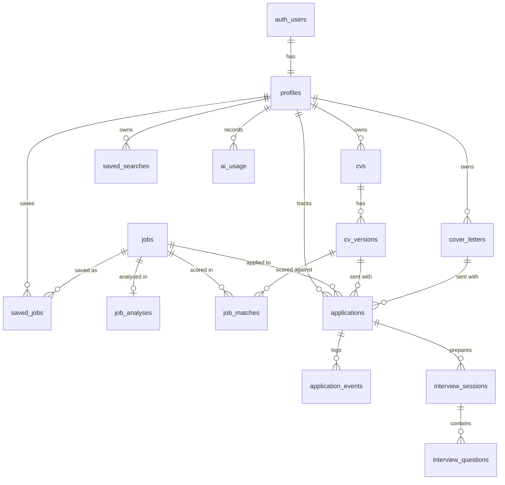

# 3. Database design

PostgreSQL on Supabase. All primary keys are UUIDs, all timestamps are `timestamptz`, and every schema change is a migration in `supabase/migrations`.

## 3.1 Entity relationships



## 3.2 Tables

### Identity

**`profiles`**: one row per `auth.users` row, created by a trigger.

| Column | Type | Notes |
| ------ | ---- | ----- |
| `id` | uuid PK | References `auth.users` on delete cascade |
| `full_name`, `headline`, `location` | text | |
| `links` | jsonb | LinkedIn, GitHub, portfolio |
| `preferences` | jsonb | Titles, locations, remote policy, salary floor, seniority |
| `ai_daily_limit_cents` | integer | Default set by plan |
| `created_at`, `updated_at` | timestamptz | |

### CVs

**`cvs`**

| Column | Type | Notes |
| ------ | ---- | ----- |
| `id` | uuid PK | |
| `user_id` | uuid FK | |
| `title` | text | |
| `storage_path` | text | Original upload in the private bucket |
| `parse_status` | enum | `pending`, `parsing`, `needs_review`, `ready`, `failed` |
| `is_primary` | boolean | Partial unique index: one primary per user |
| `created_at`, `updated_at` | timestamptz | |

**`cv_versions`**: immutable once sent, so an application always shows exactly what was submitted.

| Column | Type | Notes |
| ------ | ---- | ----- |
| `id` | uuid PK | |
| `cv_id` | uuid FK | |
| `user_id` | uuid FK | Denormalised for simple RLS |
| `label` | text | |
| `content` | jsonb | Structured CV, validated by Zod |
| `source_job_id` | uuid FK, null | Set when tailored for a job |
| `created_at` | timestamptz | |

### Jobs

**`jobs`**: shared across users, readable by any signed-in user, written only by the server.

| Column | Type | Notes |
| ------ | ---- | ----- |
| `id` | uuid PK | |
| `source` | text | `adzuna`, `manual` and so on |
| `source_job_id` | text | Unique with `source` |
| `fingerprint` | text, indexed | Hash of normalised company, title, location |
| `title`, `company`, `location` | text | |
| `remote_policy` | enum | `onsite`, `hybrid`, `remote`, `unknown` |
| `salary_min`, `salary_max` | numeric | |
| `salary_currency` | text | |
| `description` | text | |
| `url` | text | |
| `posted_at`, `expires_at` | timestamptz | |
| `search_vector` | tsvector | Generated, GIN index |
| `created_by` | uuid FK, null | For manual jobs, which stay visible only to their creator |

**`saved_jobs`**: `user_id`, `job_id` (unique together), `status` (`saved`, `hidden`), `labels text[]`, `notes`.

**`saved_searches`**: `user_id`, `name`, `query jsonb`, `notify boolean`, `last_run_at`.

### AI results

**`job_analyses`**: `job_id` (unique), `prompt_version`, `model`, `result jsonb`, `created_at`. Shared, because a job's analysis does not depend on the user.

**`job_matches`**

| Column | Type | Notes |
| ------ | ---- | ----- |
| `id` | uuid PK | |
| `user_id` | uuid FK | |
| `job_id` | uuid FK | |
| `cv_version_id` | uuid FK | Unique with `job_id` and `prompt_version` |
| `score` | smallint | Check between 0 and 100 |
| `result` | jsonb | Matched skills, gaps, evidence |
| `prompt_version`, `model` | text | |
| `created_at` | timestamptz | |

**`cover_letters`**: `user_id`, `job_id`, `cv_version_id`, `tone`, `content`, `is_edited`, `created_at`, `updated_at`.

### Applications

**`applications`**

| Column | Type | Notes |
| ------ | ---- | ----- |
| `id` | uuid PK | |
| `user_id` | uuid FK | |
| `job_id` | uuid FK, null | Null for roles tracked by hand |
| `company`, `role_title` | text | Copied so history survives job deletion |
| `status` | enum | `saved`, `applied`, `screening`, `interview`, `offer`, `accepted`, `rejected`, `withdrawn` |
| `applied_at` | timestamptz | |
| `cv_version_id`, `cover_letter_id` | uuid FK, null | What was actually sent |
| `next_action_at` | timestamptz | Follow-up reminder |
| `contacts` | jsonb | |
| `notes` | text | |

A partial unique index on `(user_id, job_id)` prevents duplicates.

**`application_events`**: append-only timeline with `application_id`, `user_id`, `type`, `from_status`, `to_status`, `note`, `occurred_at`. Written by a trigger on status change. This table is the source for analytics.

### Interview preparation

**`interview_sessions`**: `user_id`, `application_id` (nullable), `job_id`, `kind` (`behavioural`, `technical`, `mixed`), `created_at`.

**`interview_questions`**: `session_id`, `user_id`, `position`, `question`, `category`, `answer`, `feedback jsonb`.

### Operations

**`ai_usage`**: `user_id`, `feature`, `model`, `input_tokens`, `output_tokens`, `cache_read_tokens`, `cost_cents`, `stop_reason`, `created_at`. Indexed on `(user_id, created_at)`. It holds counts only and never prompt text.

## 3.3 Row level security

RLS is enabled on every table. The pattern for user-owned tables:

```sql
alter table applications enable row level security;

create policy "owner reads" on applications
  for select to authenticated
  using ((select auth.uid()) = user_id);

create policy "owner writes" on applications
  for all to authenticated
  using ((select auth.uid()) = user_id)
  with check ((select auth.uid()) = user_id);
```

Wrapping `auth.uid()` in a `select` lets Postgres evaluate it once per query rather than once per row, and every `user_id` column is indexed.

| Tables | Authenticated user | Server (service role) |
| ------ | ------------------ | --------------------- |
| User-owned tables | Own rows only | Background jobs |
| `jobs` | Read rows where `created_by` is null or their own | Write |
| `job_analyses` | Read, for jobs they can read | Write |
| `ai_usage` | Read own | Write |
| `application_events` | Read own | Written by trigger |

The service role key is used only in cron and background code, which must filter by user explicitly because it bypasses RLS.

## 3.4 Storage

| Bucket | Path | Access |
| ------ | ---- | ------ |
| `cvs` (private) | `{user_id}/{cv_id}/{filename}` | Storage policy requires the first folder to equal `auth.uid()`. Reads use signed URLs valid for 60 seconds |
| `exports` (private) | `{user_id}/{export_id}.zip` | Signed URLs, removed after 7 days |

Upload limits are set on the bucket too (5 MB, PDF and DOCX only), so they do not depend on application code.

## 3.5 Analytics

Analytics are SQL views over `applications` and `application_events`, created with `security_invoker = true` so that RLS applies to whoever queries them. Views can move to materialised views if volume requires it.

## 3.6 Retention

| Data | Kept for |
| ---- | -------- |
| Account data | Until deletion. Removal cascades through every table and storage path |
| `jobs` no longer referenced | 90 days after expiry |
| `ai_usage` | 13 months, then aggregated without a user reference |
| Exports | 7 days |
