# 7. Development roadmap

Each phase ends with something that works, with passing lint, build and tests. A phase's exit criteria must be met before the next one starts.

```mermaid
flowchart LR
    P1[1 Planning]:::done --> P2[2 Foundation]:::done --> P3[3 Auth and data]:::done --> P4[4 Job discovery]:::done --> P5[5 CV analyzer]:::done
    P5 --> P6[6 Job matching]:::done --> P7[7 Cover letters]
    P7 --> P8[8 Tracking] --> P9[9 Interview] --> P10[10 Analytics] --> P11[11 Launch]
    classDef done fill:#d1fae5,stroke:#059669,color:#064e3b
```

| Phase | Name | Deliverables | Exit criteria | Status |
| ----- | ---- | ------------ | ------------- | ------ |
| 1 | Planning | Requirements, architecture, database, pages, API, security, roadmap, testing, risks | Plan approved | ✅ Done |
| 2 | Foundation | Next.js app, Tailwind, shadcn/ui, ESLint, layouts, navigation, all initial pages | Lint and build pass, app runs locally | ✅ Done |
| 3 | Auth and data | Supabase schema, migrations, RLS, `proxy.ts`, registration, login, logout, password reset, profile and preferences, tests, CI | A user can register and sign in, and cross-user RLS tests pass | ✅ Done locally. Hosted Supabase and Vercel deployment need the owner's accounts |
| 4 | Job discovery | Provider interface, Remotive integration, sync with rate limiting, normalisation, duplicate detection, search with filters, saved jobs | Real jobs can be searched, opened at the source and saved | ✅ Done |
| 5 | AI CV analyzer | Upload, text extraction, AI gateway and budget, AI parsing, review screen, analysis dashboard | A CV becomes verified structured data with an analysis | ✅ Built. Live API check waits for a key |
| 6 | AI job matching | Requirement analysis, fixed scoring rules, evidence checks, saved results, comparison | A job gets a consistent, explained score | ✅ Built. Live API check waits for a key |
| 7 | Cover letters | Streaming generation, tone options, editor | A letter is generated, edited and saved | Planned |
| 8 | Application tracking | Board and table, timeline, documents sent, reminders, duplicate warning | The full application lifecycle works | Planned |
| 9 | Interview preparation | Question generation, practice, feedback, STAR stories | A complete practice session works | Planned |
| 10 | Analytics | Funnel, trends, source and skill insights, real dashboard | Every figure comes from real data | Planned |
| 11 | Hardening and launch | Security review, accessibility and performance audits, legal pages, monitoring, data export, account deletion | The [pre-launch checklist](06-security-plan.md#66-pre-launch-checklist) is complete | Planned |

The prompt that started Phase 2 calls it "Phase 1 of the project". This roadmap counts planning as Phase 1, so application work starts at Phase 2. Job discovery moved ahead of CV management at the owner's request.

Phases 5 and 6 follow the owner's prompts, which focus on analysis and matching. These items from the original plan are not built yet and should be scheduled: CV versions and export (CV-4, CV-5), tailoring suggestions with accept and reject (AI-4), and adding a job from pasted text.

## Minimum useful product

Phases 3 to 8 give a complete core loop: find a job, tailor documents, apply and track. Phases 9 to 11 could be reordered without blocking it.
